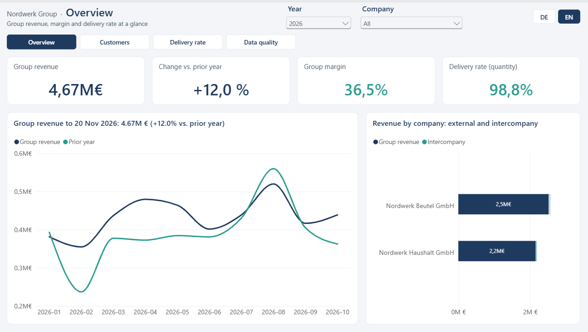
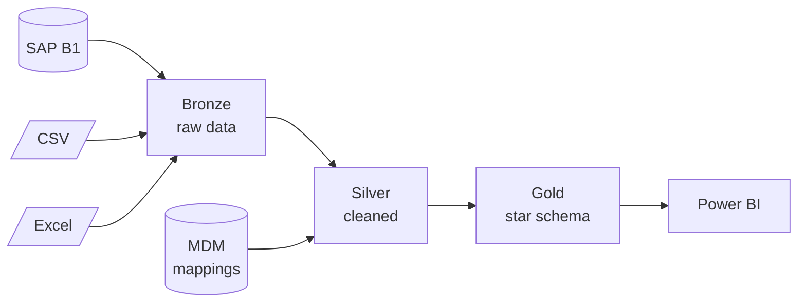
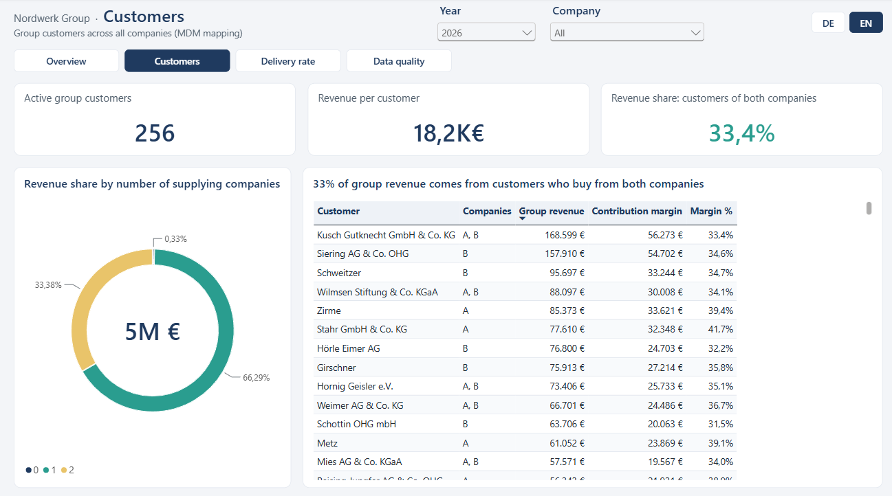
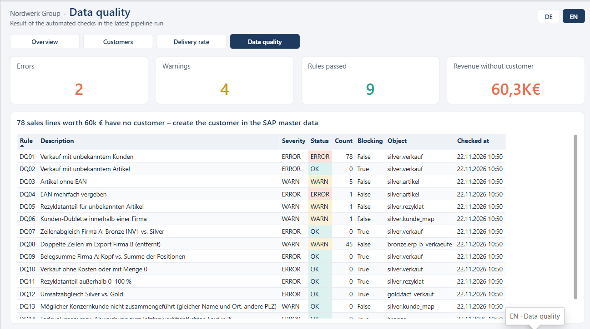

# Nordwerk Data Platform

[Deutsch](README.md) · **English**

A practice project in data integration: sales data from SAP Business One, a CSV export and an Excel file
is combined in PostgreSQL, checked, and analysed in Power BI. The company and all data are made up.



## The problem

The fictional Nordwerk Group has two companies with their own systems:

- **Nordwerk Haushalt GmbH** – SAP Business One (tables `OCRD`, `OITM`, `ORDR/RDR1`, `OINV/INV1`)
- **Nordwerk Beutel GmbH** – another ERP that delivers CSV files

The sustainability team also keeps an Excel file with recycled-material shares. 60 customers buy from both
companies, under different customer numbers. The companies also sell to each other.

Goal: one shared, checked data basis for group reporting.

## Architecture



| Layer | Content |
|---|---|
| Bronze | Sources unchanged, stored as text; the last 5 loads are kept. If a source drops a column, the run stops. |
| MDM | Data people maintain: unit mapping, manual customer matches, fixed customer IDs |
| Silver | Types, formats and units unified, duplicates removed, the same customers from both systems linked |
| Gold | Star schema for Power BI: `fact_verkauf` (sales), `fact_lieferung` (deliveries), dimensions customer, item, date, company |
| Meta | Run log and results of the quality rules |

Stack: PostgreSQL 17 (Docker), Python (pandas, SQLAlchemy), SQL, Power BI Desktop, pytest, GitHub Actions.

## Data quality

15 rules run on every load, before data is published. The rules are SQL queries stored in a table
(`meta.dq_rule`), so a new rule is a new row.

- **Blocking** (e.g. totals don't match, half a delivery missing): the layer is rolled back, and the report keeps
  showing the last good data.
- **Non-blocking** (e.g. unknown customer): the data is published, and the finding is shown in the report with its
  amount. The fix happens in the source system.

The test data contains typical errors on purpose: 78 sales lines without a known customer, a duplicate EAN,
missing EANs, a duplicate customer, duplicate rows in the CSV export, and a postcode typo that breaks the
automatic customer matching.

## Results in the report

| | |
|---|---|
| Group revenue (without sales between the companies) | €3.46M → €4.23M → €4.68M (2023–2025); 2026 to 20 Nov: +12.0 % vs. prior year |
| Contribution margin | 30.9 % (2023) → 36.5 % (2026), mainly from price increases |
| Delivery rate | Target 98 %; only 90.5 % in August/September 2025 |
| Customers of both companies | 60 of 283 customers, 33 % of 2026 group revenue |

### Report pages

The report is in German and English; the screenshots show the German pages.

| Overview | Customers |
|---|---|
|  |  |
| **Delivery rate** | **Data quality** |
|  |  |

All measures (DAX) are listed in [`docs/powerbi_measures.md`](docs/powerbi_measures.md).

## Getting started

Requirements: Windows, Python 3.12, Docker Desktop, Power BI Desktop.

```powershell
copy .env.example .env      # set a password
.\run.ps1                   # database, test data, pipeline, checks, tests
```

Then open `powerbi/Nordwerk.pbix` and refresh (server `localhost:5433`).

More commands (`.\run.ps1 <command>` or `python manage.py <command>`):

| Command | What it does |
|---|---|
| `run` | the pipeline only |
| `check` | health check with 14 expected values |
| `status` | last runs and rule results |
| `test unit` / `test all` | tests |
| `demo fix` / `block` / `schema` / `mdm` / `reset` | show the error scenarios, then reset |

Step-by-step guide: [`docs/commands.md`](docs/commands.md).

## Tests

229 tests in three folders:

- `tests/unit` – logic without a database, e.g. that a layer is rolled back when a blocking rule fails
- `tests/db` – every quality rule must catch a planted error; the columns Power BI reads must exist
- `tests/e2e` – real pipeline runs: running twice gives the same result, half a delivery is stopped

GitHub Actions runs all tests on every push against an empty database.

## Decisions

- **Bronze stores text.** No values are lost while loading, e.g. the leading zero in postcode `01067`.
- **Fixed customer IDs in their own table.** A new customer doesn't change the IDs of the others.
- **Gold doesn't depend on SAP table names.** A move to S/4HANA changes extraction and silver, not the report.
- **Loading with `COPY` instead of single `INSERT`s, JIT turned off.** On Windows, a pipeline run takes 4 seconds instead of 30.

## Limits

Full loads instead of incremental ones, no history for master data (SCD2), no credit notes from SAP (`ORIN`),
started by command instead of a scheduler, about 15,000 sales lines. In a real project these would be the next steps.

## Folders

```
etl/          pipeline (loading, running SQL, quality rules, run log)
generator/    creates the test data for the three sources
sql/          00_setup, 10_mdm, 20_silver, 30_gold, checks
tests/        unit, db, e2e
powerbi/      Nordwerk.pbix
docs/         guide, measures, screenshots
manage.py     one entry point for all commands
```
