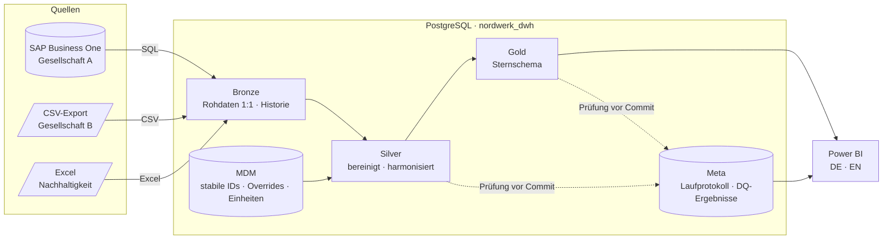
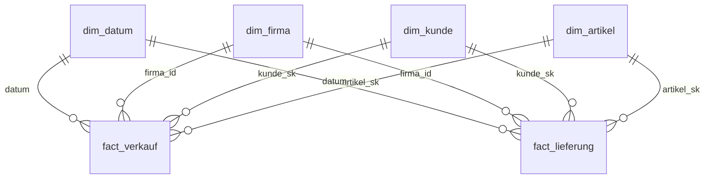
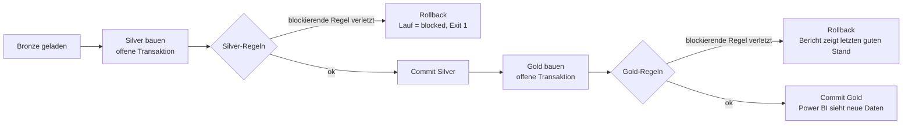

# Nordwerk Data Platform

**Konzernweite Datenintegration aus SAP Business One, einem Fremd-ERP und Excel – mit Medallion-Architektur, Stammdaten-Mapping, automatisierten Datenqualitätsprüfungen und einem dreisprachigen Power-BI-Bericht.**

> **English summary:** An end-to-end data integration platform for a fictional group of three companies.
> Sales data from an SAP Business One database, a CSV export of another ERP and a hand-maintained Excel
> file is loaded into PostgreSQL in a bronze / silver / gold architecture with a master data layer
> (stable keys, manual matches, unit mapping). 15 data quality rules check each layer *before* it is
> published; blocking failures roll the layer back, so the Power BI report (German and English) always
> shows the last good data. One command (`manage.py showcase`) builds and verifies everything; 229 unit, database and end-to-end tests run in GitHub Actions. All data is synthetic.

---

## Inhalt

1. [Ausgangslage](#ausgangslage)
2. [Architektur](#architektur)
3. [Quellsysteme](#quellsysteme)
4. [Die Schichten](#die-schichten)
5. [Datenmodell (Gold)](#datenmodell-gold)
6. [Datenqualität](#datenqualität)
7. [Kennzahlenkatalog](#kennzahlenkatalog)
8. [Was die Daten erzählen](#was-die-daten-erzählen)
9. [Power-BI-Bericht](#power-bi-bericht)
10. [Tests und CI](#tests-und-ci)
11. [Schnellstart](#schnellstart)
12. [Designentscheidungen](#designentscheidungen)
13. [S/4HANA-Readiness](#s4hana-readiness)
14. [Grenzen dieses Projekts](#grenzen-dieses-projekts)
15. [Projektstruktur](#projektstruktur)
16. [Roadmap](#roadmap)

---

## Ausgangslage

Die fiktive **Nordwerk Gruppe** besteht aus drei Gesellschaften mit eigenen Systemen:

| Gesellschaft | Sortiment | System |
|---|---|---|
| **Nordwerk Haushalt GmbH** (A) | Reinigungsmittel, Küchenhelfer, Aufbewahrung | SAP Business One |
| **Nordwerk Beutel GmbH** (B) | Müllbeutel | anderes ERP, CSV-Export |
| **Nordwerk Handschuhe GmbH** (C) | Handschuhe | REST-API (in Planung) |

Dieselben Händler kaufen bei mehreren Gesellschaften – unter unterschiedlichen Kundennummern und Schreibweisen.
Die Gesellschaften verkaufen auch untereinander. Ziel ist **eine verlässliche Datenbasis für den ganzen Konzern**.

Das Projekt ist entlang der vier Aufgaben einer Data-Integration-Rolle aufgebaut:

| Aufgabe | Umsetzung im Projekt |
|---|---|
| **Daten zusammenbringen** | SAP-B1-Datenbank, CSV-Export und Excel in einer Plattform |
| **Daten in Bewegung halten** | Python-Pipeline mit Laufprotokoll, ein Befehl für alle Schichten, Schema-Prüfung der Quellen |
| **Verlässliche Datenbasis** | Sternschema, 15 Prüfregeln *vor* der Veröffentlichung, Abgleich Quelle ↔ Bericht auf den Cent, 229 automatisierte Tests auf drei Ebenen |
| **Technik und Fachbereiche verbinden** | MDM-Schicht mit stabilen IDs und manuellen Zuordnungen, Kennzahlenkatalog, Bericht auf Deutsch und Englisch |

---

## Architektur



| Komponente | Technik |
|---|---|
| Datenbank | PostgreSQL 17 in Docker |
| Extraktion und Laden | Python (pandas, SQLAlchemy, psycopg) |
| Transformationen | SQL (Silver, Gold), je Schicht **eine Transaktion** |
| Orchestrierung | `etl/run_pipeline.py`: Laufprotokoll, Log-Datei, Exit-Code |
| Datenqualität | Regeln als Daten in `meta.dq_rule` (Phase, blockierend, Schwellwert), Ergebnisse in `meta.dq_result` |
| Tests | pytest auf drei Ebenen (Unit, Datenbank, End-to-End), Coverage, ruff, GitHub Actions mit eigener PostgreSQL |
| Bericht | Power BI Desktop (`powerbi/Nordwerk.pbix`), Import aus Gold |

---

## Quellsysteme

Die Quelldaten werden synthetisch erzeugt (`generator/`) – mit **absichtlich eingebauten Datenproblemen**,
wie sie in echten Systemen vorkommen. Fester Stichtag **20.11.2026**, Historie ab **Dezember 2022**: Jeder Lauf
erzeugt exakt dieselben Daten, 2023–2025 sind vollständige Jahre, jeder Vorjahresvergleich ist gültig.

| Quelle | Inhalt | Eingebaute Probleme |
|---|---|---|
| **SAP Business One** (`src_sap_b1`) | Original-Tabellenstruktur: `OCRD`, `OITB`, `OITM`, `ORDR`/`RDR1`, `OINV`/`INV1` | Artikel ohne EAN, doppelte EAN, Aufträge mit unbekanntem Kunden, Kunden-Dublette, Teillieferungen, Konzerngesellschaften als Kunden |
| **CSV-Export Gesellschaft B** | `kunden.csv`, `artikel.csv`, `verkaeufe.csv` | `;`-Trennzeichen, Dezimalkomma, `TT.MM.JJJJ`, Windows-1252, andere Einheiten (Rolle/Karton/Palette), doppelte Zeilen, Gutschriften negativ, 60 Kunden auch bei A – mit anderen Nummern und Schreibweisen, ein PLZ-Tippfehler |
| **Excel Nachhaltigkeit** | Rezyklatanteil je Artikel | Titelzeilen über der Tabelle, Prozentwerte teils als Text (`"45 %"`), unbekannte Artikelnummer, Historie (gültig ab) |

---

## Die Schichten

### Bronze – Rohdaten
Jede Quelle wird **unverändert** übernommen, alle Werte als Text, plus `_source_system`, `_source_object`,
`_run_id`, `_load_ts`.

- **Historie:** `bronze.<quelle>_hist` wird nur angehängt (die letzten 5 Ladungen bleiben erhalten),
  die View `bronze.<quelle>` zeigt die neueste Ladung. So lässt sich jede Zahl bis zur Lieferung zurückverfolgen.
- **Schema-Prüfung:** Fehlt einer Quelle eine bekannte Spalte, stoppt der Lauf mit `SchemaDriftError`.
  Neue Spalten werden protokolliert und ignoriert, bis Silver sie nutzt.
- Jede Ladung steht in `meta.load_log`, jeder Lauf in `meta.etl_run`.

### MDM – Stammdaten, die Menschen pflegen
| Tabelle | Inhalt |
|---|---|
| `einheit_map` | Quell-Einheit → Konzern-Einheit (STK/KRT/PAL). Neue Einheit = neue Zeile, kein Code |
| `kunde_override` | manuelle Kundenzuordnung durch das MDM-Team, schlägt den automatischen Abgleich (Beispiel: PLZ-Tippfehler bei B-K-4011) |
| `konzern_kunde` | **stabile** Konzern-Kunden-ID je Abgleichsschlüssel (`GK00001` …), wird nie neu vergeben |
| `artikel_schluessel` | stabiler Surrogatschlüssel je Artikel |

### Silver – bereinigt und harmonisiert
| Tabelle | Inhalt |
|---|---|
| `firma` | Konzerngesellschaften |
| `artikel` | Artikel aller Gesellschaften, **eine** Einheitensprache über `mdm.einheit_map` |
| `kunde`, `kunde_map` | Kunden aller Gesellschaften → **eine Konzern-Kunden-ID**: automatisch über normalisierten Namen + PLZ, manuell über `mdm.kunde_override`; Intercompany-Kennzeichen |
| `verkauf` | alle Rechnungspositionen, dedupliziert, typisiert, Menge in Stück, mit Kosten |
| `auftrag` | Auftragspositionen mit gelieferter Menge (Basis der Lieferquote) |
| `rezyklat` | Rezyklatanteil mit Gültigkeitszeiträumen (gültig ab / bis) |

### Gold – Sternschema für Power BI
Siehe nächster Abschnitt.

---

## Datenmodell (Gold)



| Tabelle | Granularität / Inhalt |
|---|---|
| `fact_verkauf` | eine Rechnungsposition: Umsatz, Kosten, Deckungsbeitrag, Menge, Intercompany-Kennzeichen |
| `fact_lieferung` | eine Auftragsposition: bestellte und gelieferte Menge |
| `dim_kunde` | ein Konzernkunde (Golden Record), `-1` = Unbekannter Kunde |
| `dim_artikel` | ein Artikel mit aktuellem Rezyklatanteil, `-1` = Unbekannter Artikel |
| `dim_datum` | Kalender mit deutschen Namen, ISO-Woche und Abdeckungs-Kennzeichen (vollständige Monate, Datenbeginn, Datenstand) |
| `dim_firma` | Konzerngesellschaften |

Surrogatschlüssel kommen aus der MDM-Schicht und bleiben bei jedem Neuaufbau gleich (`GK00042` → `kunde_sk` 42).
Primär- und Fremdschlüssel sowie Indizes sind gesetzt.

---

## Datenqualität

Die Prüfregeln sind **Daten, keine Code-Logik**: Jede Regel ist eine SQL-Abfrage in `meta.dq_rule`, die eine Zahl
zurückgibt. Eine neue Regel ist eine neue Zeile. Jede Regel hat eine **Phase**, ein **Blockier-Kennzeichen** und einen
**Schwellwert**.



| Regel | Prüfung | Schwere | Blockiert | Art |
|---|---|---|---|---|
| DQ01 | Verkauf mit unbekanntem Kunden | ERROR | – | Referenzielle Integrität |
| DQ02 | Verkauf mit unbekanntem Artikel | ERROR | ✔ | Referenzielle Integrität |
| DQ03 | Artikel ohne EAN | WARN | – | Vollständigkeit |
| DQ04 | EAN mehrfach vergeben | ERROR | – | Eindeutigkeit |
| DQ05 | Rezyklatanteil für unbekannten Artikel | WARN | – | Referenzielle Integrität |
| DQ06 | Kunden-Dublette innerhalb einer Firma | WARN | – | Eindeutigkeit |
| DQ07 | Zeilenabgleich Bronze ↔ Silver (Firma A) | ERROR | ✔ | Abgleich |
| DQ08 | Doppelte Zeilen im Export Firma B | WARN | – | Abgleich |
| DQ09 | Belegsumme Kopf ↔ Positionen | ERROR | ✔ | Abgleich |
| DQ10 | Verkauf ohne Kosten oder mit Menge 0 | ERROR | ✔ | Plausibilität |
| DQ11 | Rezyklatanteil außerhalb 0–100 % | ERROR | ✔ | Plausibilität |
| DQ12 | Umsatz Silver = Gold (Toleranz 0,01 €) | ERROR | ✔ | Abgleich |
| DQ13 | Möglicher Konzernkunde nicht zusammengeführt (gleicher Name und Ort, andere PLZ) | WARN | – | MDM |
| DQ14 | Ladevolumen weicht > 30 % vom letzten veröffentlichten Lauf ab | ERROR | ✔ | Volumen |
| DQ15 | Position ohne Datum im Kalender | ERROR | ✔ | Referenzielle Integrität |

**Zwei Stufen:**
- **Blockierend** – die Daten wären falsch (Summen stimmen nicht, halbe Lieferung): Die Schicht wird zurückgerollt,
  der Lauf endet mit `blocked` und Exit-Code 1, Power BI zeigt weiter den letzten guten Stand.
- **„Publish and flag“** – die Daten sind korrekt summiert, aber unvollständig zugeordnet (z. B. unbekannter Kunde →
  Unbekannt-Eintrag `-1`): Die Daten werden veröffentlicht, der Befund steht im Bericht, mit Betrag in Euro.
  Behoben wird **an der Quelle** – beim nächsten Lauf verschwindet der Befund automatisch.

Die DQ-Ergebnisse werden auch bei einem Rollback gespeichert (eigene Verbindung), damit sichtbar bleibt, *warum*
ein Lauf gestoppt hat (`meta.v_lauf_historie`).

---

## Kennzahlenkatalog

| Kennzahl | Fachliche Definition | Formel (DAX) | Quelle | Verantwortlich |
|---|---|---|---|---|
| **Umsatz** | Nettoumsatz aus Rechnungen, Gutschriften abgezogen | `SUM(Verkauf[umsatz_netto])` | OINV/INV1, Export B | Controlling |
| **Konzernumsatz** | Umsatz ohne Verkäufe zwischen Konzerngesellschaften | `CALCULATE([Umsatz], Verkauf[ist_intercompany] = FALSE())` | wie oben | Controlling |
| **Deckungsbeitrag** | Umsatz minus Wareneinsatz | `[Umsatz] - [Kosten]` | INV1.stockprice, Artikel B | Controlling |
| **DB-Marge Konzern** | Deckungsbeitrag ÷ Umsatz, ohne Intercompany | `DIVIDE(...)` | wie oben | Controlling |
| **Veränderung zum Vorjahr** | Konzernumsatz ggü. dem **vergleichbaren** Vorjahreszeitraum: gleicher Kalenderzeitraum, bis zum gleichen Tag (Datenstand). Leer („–“), wenn das Vorjahr nicht vollständig in den Daten liegt | `EDATE`, `DATESBETWEEN`, Prüfung gegen `Datenbeginn` | wie oben | Vertrieb |
| **Umsatztrend je Monat** | Konzernumsatz nur für **vollständige** Monate; Vorjahreslinie nur, wenn auch der Vorjahresmonat vollständig ist – angebrochene Monate am Rand der Daten verfälschen sonst den Trend | Flag `ist_vollstaendiger_monat` aus Gold | `dim_datum` | Controlling |
| **Lieferquote (Menge)** | gelieferte ÷ bestellte Stück, nur fällige, nicht stornierte Aufträge | `DIVIDE(geliefert, bestellt)` | ORDR/RDR1, INV1 | Logistik |
| **Lieferquote (Positionen)** | Anteil vollständig gelieferter Auftragspositionen | `DIVIDE(vollständig, alle)` | wie oben | Logistik |
| **Aktive Konzernkunden** | Externe Konzernkunden mit Umsatz, ohne Unbekannt und ohne Konzerngesellschaften | `DISTINCTCOUNT` | Kunden-Mapping | Vertrieb |
| **Umsatzanteil Kunden beider Gesellschaften** | Anteil des Konzernumsatzes mit Kunden, die bei mehr als einer Gesellschaft kaufen | `CALCULATE(..., Kunde[anzahl_firmen] >= 2)` | Kunden-Mapping | Vertrieb |
| **Umsatz ohne Kundenzuordnung** | Umsatz der Positionen, deren Kunde im Kundenstamm fehlt (Unbekannt `-1`) – macht den Datenfehler in Euro sichtbar | `CALCULATE([Umsatz], Verkauf[kunde_sk] = -1)` | DQ01 | Stammdaten |
| **DQ Fehler / Warnungen** | Regeln mit Befund im letzten Lauf (Fehler inkl. blockiert) | `COUNTROWS` | `meta.v_dq_aktuell` | Data Engineering |

**Zeitraumlogik:** Der Jahresfilter wählt genau ein Jahr, standardmäßig das neueste. Alle Kennzahlen gelten bis zum
**Datenstand** (letztes Rechnungsdatum); Seitentitel formulieren die Kernaussage dynamisch, z. B.
„Konzernumsatz bis 20.11.2026: 4,67 Mio. € (+12,0 % ggü. Vorjahr)“.

**Stichtag der Lieferquote:** „fällig“ bezieht sich auf das letzte Rechnungsdatum im Extrakt,
nicht auf das heutige Datum – sonst sinkt die Kennzahl ohne fachlichen Grund, wenn die Pipeline später läuft.

---

## Was die Daten erzählen

Stand 20.11.2026, Konzernsicht (ohne Intercompany). Die Muster sind in den Testdaten angelegt – der Bericht muss sie finden.

| Befund | Zahl | Wo im Bericht |
|---|---|---|
| **Wachstum** | Konzernumsatz 3,46 → 4,23 → 4,68 Mio. € (2023–2025); 2026 bis 20.11. **+12,0 %** ggü. Vorjahreszeitraum | Übersicht, Titel und Trend |
| **Marge steigt** | DB-Marge 30,9 % (2023) → 36,5 % (2026), getrieben durch jährliche Preiserhöhungen von 3 % | Übersicht |
| **Zwei Saisonmuster** | Gesellschaft A (Reinigung): Frühjahr und Dezember stark; Gesellschaft B (Müllbeutel): Sommerspitze im August | Übersicht, Monatstrend je Gesellschaft |
| **Lieferproblem** | Lieferquote Aug./Sep. 2025 nur **90,5 %** (Ziel 98 %), sonst ~99 %; 2026: 98,8 % | Lieferquote |
| **Kunden beider Gesellschaften** | 60 von 283 Konzernkunden kaufen bei A und B – **33 %** des Konzernumsatzes 2026 | Kunden |
| **Einzelkunden** | ein Kunde wächst 2026 deutlich, ein größerer Kunde kauft seit April 2026 nicht mehr | Kunden, Drill-down |
| **Datenqualität** | 78 Positionen (60 Tsd. €) ohne Kundenzuordnung, 1 doppelte EAN, 45 doppelte Zeilen im Export B | Datenqualität |

---

## Power-BI-Bericht

Vier Seiten auf **Deutsch und Englisch**, mit Seitennavigation und Sprachumschaltung (gleiche Seite in der anderen Sprache).
Jahr- und Gesellschaftsfilter sind seitenübergreifend synchronisiert.

| Seite | Inhalt |
|---|---|
| **Übersicht** | Konzernumsatz, DB-Marge, Vorjahresvergleich, Lieferquote; Umsatz nach Monat; Umsatz je Gesellschaft mit/ohne Intercompany |
| **Kunden** | Konzernkunden nach Umsatz, Anteil von Kunden mehrerer Gesellschaften |
| **Lieferquote** | Lieferquote nach Monat, Artikel mit der niedrigsten Lieferquote |
| **Datenqualität** | Ergebnis der 15 Prüfregeln im letzten Lauf, blockierende Regeln gekennzeichnet |

Jede Seite hat einen **Erkenntnis-Titel** statt einer Überschrift: eine DAX-Kennzahl formuliert die Aussage
der Seite aus den aktuellen Daten (z. B. „Konzernumsatz bis 20.11.2026: 4,67 Mio. € (+12,0 % ggü. Vorjahr)“).
Vorjahresvergleiche nutzen nur Zeiträume, die vollständig in den Daten liegen.

Der Bericht liest nur die Gold-Tabellen und `meta.v_dq_aktuell` (Import). Alle Kennzahlen mit Beschreibung stehen in
[`docs/powerbi_measures.md`](docs/powerbi_measures.md). Welche Spalten der Bericht braucht, sichert der Test
`tests/db/test_gold_contract.py` (`REPORT_CONTRACT`): Benennt jemand eine Gold-Spalte um, schlägt der Test fehl,
bevor der Bericht beim Aktualisieren bricht.

<!-- Screenshots: docs/img/uebersicht.png, docs/img/kunden.png, docs/img/lieferquote.png, docs/img/datenqualitaet.png -->
| Übersicht | Datenqualität |
|---|---|
|  |  |
| **Kunden** | **Lieferquote** |
|  |  |

---

## Tests und CI

**229 Tests auf drei Ebenen**, ausgewählt über den Ordner (Marker werden automatisch gesetzt):

| Ebene | Ordner | Anzahl | Was geprüft wird | Datenbank |
|---|---|---|---|---|
| **Unit** | `tests/unit` | 126 | Spaltennamen, Schema-Vertrag, Bewertung der DQ-Regeln, **Commit/Rollback-Logik der Pipeline mit Fake-Verbindungen**, Exit-Codes, SQL-Runner, Logging, Verbindung aus `.env`; Generatoren (geplante Datenfehler, Saison, Wachstum, Preise, Reproduzierbarkeit); statische Prüfung von SQL-Dateien und Regelkatalog (jede Tabelle wird vor dem Neuaufbau gelöscht, blockierende Regeln sind Fehler, kein Passwort im Code) | nein, ~3 s |
| **Datenbank** | `tests/db` | 81 | SQL-Funktionen (`norm_name`), Kalender; **jede DQ-Regel erkennt einen absichtlich eingebauten Fehler** (Mutationstest, per Rollback); **Vertrag Gold ↔ Power BI** (jede Spalte, die der Bericht liest, existiert mit passendem Typ); Schlüssel, Fremdschlüssel, Unbekannt-Einträge, Kalender; Kennzahlen der Datengeschichte | ja, Änderungen werden zurückgerollt |
| **End-to-End** | `tests/e2e` | 22 | echte Pipeline als eigener Prozess: Neuaufbau, **Idempotenz** (Fingerabdruck von Gold), stabile Schlüssel, Bronze-Historie, Fehler an der Quelle beheben, **gestoppte Lieferung**, **Schema-Änderung**, manuelle MDM-Zuordnung, blockierende Regel, Health-Check | ja, ~45 s |

```powershell
python manage.py test unit        # schnell, ohne Datenbank
python manage.py test all --cov   # alles, mit Coverage-Bericht (logs/coverage/index.html)
```

Code-Abdeckung (in-process gemessen): **89 %** für `etl/` und `generator/`. Die Unit-Tests haben einen echten Fehler
gefunden: Müllbeutel bekamen wegen Groß-/Kleinschreibung („Müll**b**eutel“) den falschen Rezyklatbereich.

**GitHub Actions** (`.github/workflows/nordwerk.yml` im Repository-Root), zwei Jobs:
1. *Lint und Unit-Tests* – ohne Datenbank, schnelle Rückmeldung bei jedem Push
2. *Pipeline, Datenbank- und End-to-End-Tests* – startet eine leere PostgreSQL 17, baut alles von null,
   Health-Check, Tests mit Coverage; Testergebnisse und Pipeline-Log als Artefakte

---

## Schnellstart

Voraussetzungen: Python 3.12, Docker Desktop, Power BI Desktop (Windows).

```powershell
git clone https://github.com/walidsharaar/python_projects.git
cd "python_projects/045_Nordwerk Data Platform"

python -m venv .venv
.venv\Scripts\activate
python -m pip install -r requirements.txt

.\run.ps1                          # alles mit einem Befehl (siehe unten)
```

`run.ps1` legt bei Bedarf die virtuelle Umgebung an, installiert die Pakete und ruft `python manage.py showcase` auf:
`.env` anlegen → PostgreSQL in Docker starten → Quellen erzeugen → Pipeline → Health-Check → Status →
Lint → 229 Tests mit Coverage. Dauer: wenige Minuten (die End-to-End-Tests bauen das Lager mehrfach neu auf).

| Befehl (`python manage.py …` oder `.\run.ps1 …`) | Wirkung |
|---|---|
| `showcase` | alles, siehe oben |
| `setup` | `.env` anlegen, Datenbank starten, warten bis bereit |
| `run [--generate]` | Pipeline (mit neuen Quelldaten) |
| `check` / `status` | Health-Check / letzte Läufe und Datenqualität |
| `test unit\|db\|e2e\|all [--cov]` | Tests |
| `lint` | Codestil (ruff) |
| `demo fix\|block\|schema\|mdm\|reset` | die vier Vorführungen und Zurücksetzen |

Danach `powerbi/Nordwerk.pbix` öffnen und **Aktualisieren** klicken (Server `localhost:5433`, Benutzer `nordwerk`, Verschlüsselung aus).

Schritt-für-Schritt-Anleitung und alle Befehle: [docs/commands.md](docs/commands.md)

---

## Designentscheidungen

| Entscheidung | Begründung |
|---|---|
| **Medallion (Bronze/Silver/Gold)** | Rohdaten bleiben nachvollziehbar; Regeln können korrigiert und Silver neu gebaut werden, ohne die Quellen erneut abzufragen |
| **Transformationen in SQL, je Schicht eine Transaktion** | Silver und Gold werden vollständig neu gebaut (bei dieser Datenmenge in Sekunden) und erst nach bestandener Prüfung committet – nie ein halb fertiger Stand im Bericht |
| **Bulk-Load mit `COPY`** | statt einer `INSERT`-Anweisung je Zeile: Quellen und Bronze laden in wenigen Sekunden statt in ~50 s (gemessen unter Windows mit Docker) |
| **Bronze als Text, nur anhängen** | keine stillen Konvertierungsfehler (PLZ `01067` bleibt erhalten); frühere Lieferungen bleiben zum Vergleich erhalten |
| **Stabile Schlüssel in `mdm`** | Konzern-Kunden-IDs und Surrogatschlüssel ändern sich nicht, wenn ein neuer Kunde dazukommt – Lesezeichen, Exporte und Folgesysteme bleiben gültig |
| **Kunden-Mapping mit Overrides** | automatischer Abgleich über normalisierten Namen + PLZ; das MDM-Team korrigiert Sonderfälle per Tabellenzeile, ohne Code-Änderung; DQ13 meldet Kandidaten |
| **Blockierend vs. „publish and flag“** | falsche Summen stoppen die Veröffentlichung, unvollständige Zuordnungen werden sichtbar gemacht statt versteckt |
| **Golden Record** | ein Name je Konzernkunde nach fester Regel: normale Schreibweise vor Großbuchstaben, SAP B1 als führendes System |
| **Intercompany als Kennzeichen** | Einzelgesellschaft sieht ihren vollen Umsatz, Konzernsicht eliminiert Intercompany – eine Faktentabelle für beide Sichten |
| **Unbekannt-Einträge (`-1`)** | Umsätze gehen nicht verloren, während die Quelle korrigiert wird |
| **Prüfregeln als Daten** | neue Regel = neue Zeile; Ergebnisse mit Historie für den Bericht |
| **Reproduzierbare Testdaten** | fester Stichtag, feste Seeds zur Laufzeit, exakte Paketversionen – Tests können konkrete Zahlen erwarten |
| **Zugangsdaten in `.env`** | Passwörter nie im Repository |

---

## S/4HANA-Readiness

Power BI liest **ausschließlich aus Gold**. Gold hat eigene Surrogatschlüssel und ist von den
SAP-Business-One-Tabellen entkoppelt. Bei einer Migration von Gesellschaft A auf **SAP S/4HANA** ändern sich nur:

1. die Extraktion (`etl/load_bronze.py`: neue Quelle, z. B. CDS-Views),
2. die Abbildung in Silver (`sql/20_silver/`: neue Feldnamen auf dieselben Zieltabellen),
3. ggf. Einträge der MDM-Tabellen (Einheiten, Kundenzuordnungen).

**Gold, Kennzahlen, Prüfregeln und Berichte bleiben unverändert.**

---

## Grenzen dieses Projekts

Bewusst einfach gehalten – und was in einer produktiven Umgebung anders wäre:

| Thema | Hier | Produktiv |
|---|---|---|
| Ladeart | Vollladung bei jedem Lauf | inkrementell über `UpdateDate` und Watermark |
| Orchestrierung | ein Python-Befehl | Scheduler (z. B. Airflow) mit Wiederholung und Alarmierung |
| Historie in Dimensionen | aktueller Stand (SCD Typ 1) | SCD Typ 2, z. B. Rezyklatanteil zum Verkaufszeitpunkt |
| Gutschriften Firma A | nicht enthalten | `ORIN`/`RIN1` |
| Kundenabgleich | Name + PLZ, exakt nach Normalisierung | zusätzlich unscharfer Abgleich mit Freigabe-Workflow |
| Daten | synthetisch, ~15.000 Verkaufspositionen | Volumen und Lastverhalten wären neu zu messen |

---

## Projektstruktur

```
python_projects/
├── .github/workflows/nordwerk.yml  CI: Lint + Unit, dann Pipeline + Datenbank + End-to-End
└── 045_Nordwerk Data Platform/
    ├── manage.py                   ein Einstieg für alles (showcase, run, test, demo …)
    ├── run.ps1 / Makefile          Ein-Klick-Start für Windows / Linux, macOS
    ├── pyproject.toml              Test-, Coverage- und Lint-Konfiguration
    ├── docker-compose.yml          PostgreSQL 17 (Port 5433)
    ├── .env.example                Vorlage für Zugangsdaten
    ├── requirements.txt            exakte Paketversionen
    ├── generator/                  simulierte Quellsysteme (SAP B1, CSV, Excel), fester Stichtag
    ├── etl/
    │   ├── db.py                   Datenbankverbindung aus .env
    │   ├── runlog.py               Laufprotokoll und Logging
    │   ├── run_sql.py              führt SQL-Dateien aus (einzeln oder als Schicht-Transaktion)
    │   ├── load_bronze.py          Quellen → Bronze, Historie, Schema-Prüfung
    │   ├── run_dq.py               Prüfregeln bewerten und speichern
    │   ├── run_pipeline.py         alle Schritte mit einem Befehl
    │   └── healthcheck.py          Soll-Ist-Prüfung mit Exit-Code
    ├── sql/
    │   ├── 00_setup/               Schemata, Protokoll, Prüfregeln, Views
    │   ├── 10_mdm/                 Einheiten, manuelle Zuordnungen, stabile Schlüssel
    │   ├── 20_silver/              Bereinigung, Harmonisierung, Kundenabgleich
    │   ├── 30_gold/                Sternschema mit Kalender
    │   └── checks/healthcheck.sql  Soll-Ist-Prüfung nach jedem Lauf
    ├── tests/
    │   ├── unit/                   ohne Datenbank: Logik, Generatoren, SQL- und Power-BI-Definition
    │   ├── db/                     Regeln, Verträge, Integrität, Datengeschichte (mit Rollback)
    │   └── e2e/                    echte Pipeline-Läufe und Fehlerszenarien
    ├── powerbi/
    │   ├── Nordwerk.pbix           Power-BI-Bericht (DE/EN)
    │   └── README.md               Verbindung und Hinweise
    └── docs/
        ├── commands.md             Schritt-für-Schritt-Anleitung und Demos
        ├── powerbi_measures.md     alle DAX-Kennzahlen mit Beschreibung
        └── img/                    Screenshots
```

---

## Roadmap

- **Gesellschaft C** als REST-API-Quelle (FastAPI) mit Paginierung, Rate-Limits und Wiederholungsversuchen
- **Inkrementelle Ladevorgänge** über `UpdateDate` und Watermark-Tabelle
- **Orchestrierung mit Apache Airflow** (DAG über die bestehenden Pipeline-Schritte, Alarmierung bei `blocked`)
- **SCD Typ 2** für Artikel (Rezyklatanteil zum Verkaufszeitpunkt)
- **Gutschriften aus SAP B1** (`ORIN`/`RIN1`)
- **Unscharfer Kundenabgleich** (`pg_trgm`) mit Freigabe durch das MDM-Team

---

*Alle Daten sind synthetisch. Firmennamen sind frei erfunden.*
