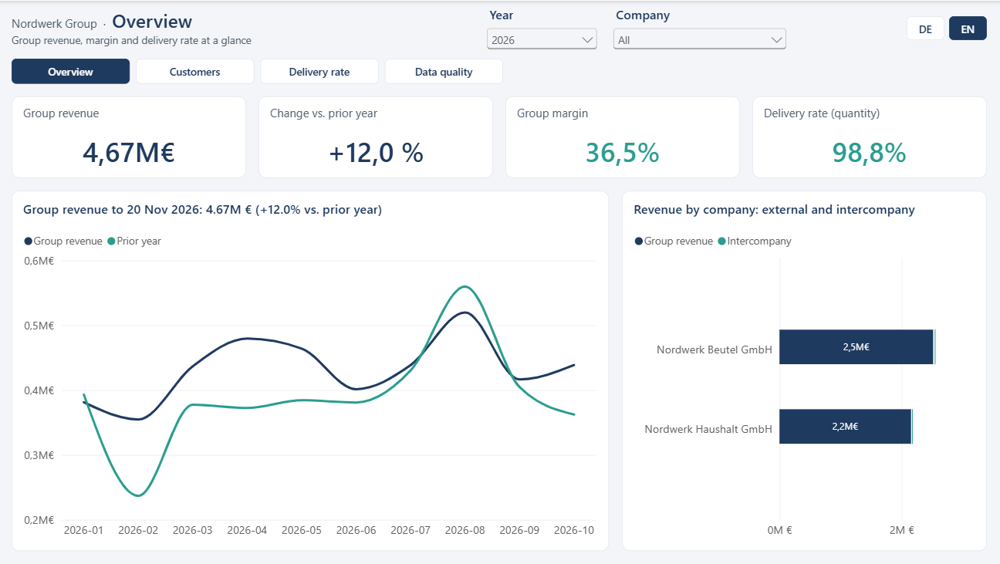
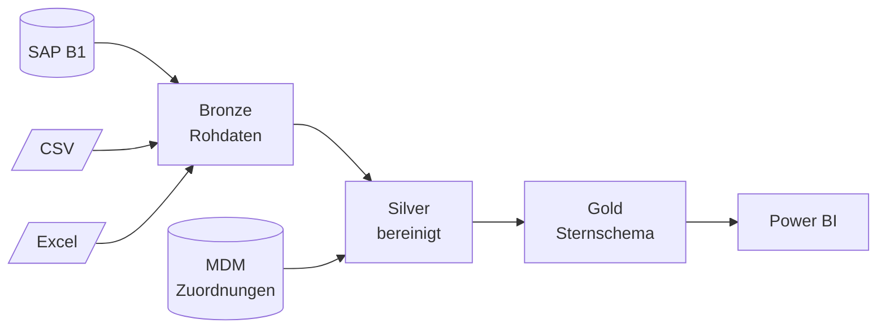
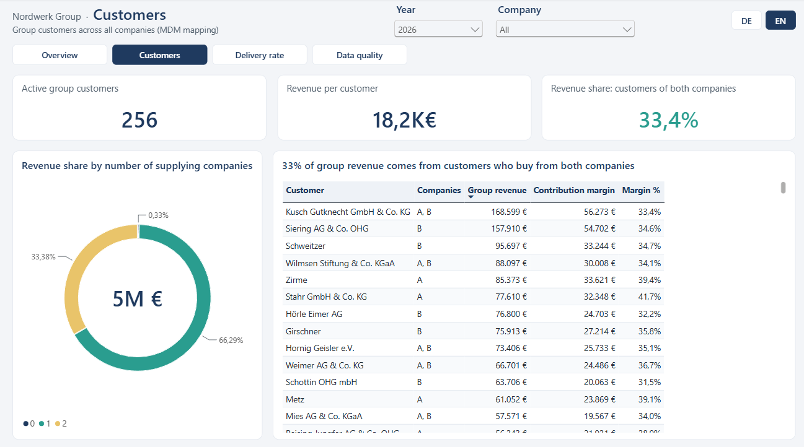
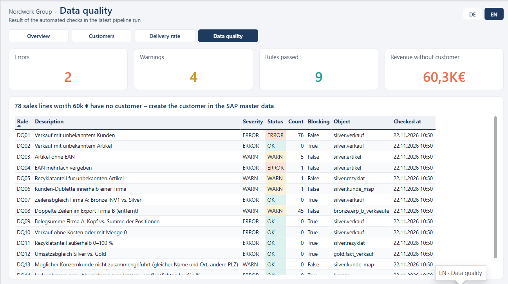

# Nordwerk Data Platform

**Deutsch** · [English](README.en.md)

Ein Übungsprojekt zur Datenintegration: Verkaufsdaten aus SAP Business One, einem CSV-Export und einer Excel-Datei
werden in PostgreSQL zusammengeführt, geprüft und in Power BI ausgewertet. Firma und Daten sind erfunden.



## Worum es geht

Die fiktive Nordwerk Gruppe hat zwei Gesellschaften mit eigenen Systemen:

- **Nordwerk Haushalt GmbH** – SAP Business One (Tabellen `OCRD`, `OITM`, `ORDR/RDR1`, `OINV/INV1`)
- **Nordwerk Beutel GmbH** – anderes ERP, liefert CSV-Dateien

Dazu pflegt das Nachhaltigkeitsteam eine Excel-Datei mit Rezyklatanteilen. 60 Kunden kaufen bei beiden
Gesellschaften, unter verschiedenen Kundennummern. Die Gesellschaften verkaufen auch untereinander.

Ziel: eine gemeinsame, geprüfte Datenbasis für den Konzernbericht.

## Aufbau



| Schicht | Inhalt |
|---|---|
| Bronze | Quellen unverändert als Text, die letzten 5 Ladungen bleiben erhalten. Fehlt einer Quelle eine Spalte, stoppt der Lauf. |
| MDM | Was Menschen pflegen: Einheiten-Zuordnung, manuelle Kundenzuordnungen, feste Kunden-IDs |
| Silver | Typen, Formate und Einheiten vereinheitlicht, Dubletten entfernt, gleiche Kunden aus beiden Systemen verbunden |
| Gold | Sternschema für Power BI: `fact_verkauf`, `fact_lieferung`, Dimensionen Kunde, Artikel, Datum, Firma |
| Meta | Laufprotokoll und Ergebnisse der Prüfregeln |

Technik: PostgreSQL 17 (Docker), Python (pandas, SQLAlchemy), SQL, Power BI Desktop, pytest, GitHub Actions.

## Datenqualität

15 Prüfregeln laufen bei jedem Lauf, bevor Daten veröffentlicht werden. Die Regeln stehen als SQL in einer
Tabelle (`meta.dq_rule`), eine neue Regel ist eine neue Zeile.

- **Blockierend** (z. B. Summen stimmen nicht, halbe Lieferung): Die Schicht wird zurückgerollt, der Bericht zeigt
  weiter den letzten guten Stand.
- **Nicht blockierend** (z. B. unbekannter Kunde): Die Daten werden veröffentlicht, der Befund steht mit Betrag im
  Bericht. Behoben wird in der Quelle.

Die Testdaten enthalten absichtlich typische Fehler: 78 Verkaufspositionen ohne bekannten Kunden, eine doppelte EAN,
fehlende EANs, eine Kunden-Dublette, doppelte Zeilen im CSV-Export und einen PLZ-Tippfehler, der den automatischen
Kundenabgleich verhindert.

## Ergebnisse im Bericht

| | |
|---|---|
| Konzernumsatz (ohne Verkäufe untereinander) | 3,46 → 4,23 → 4,68 Mio. € (2023–2025), 2026 bis 20.11.: +12,0 % zum Vorjahr |
| Deckungsbeitrag | 30,9 % (2023) → 36,5 % (2026), vor allem durch Preiserhöhungen |
| Lieferquote | Ziel 98 %, im August/September 2025 nur 90,5 % |
| Kunden beider Gesellschaften | 60 von 283 Kunden, 33 % des Konzernumsatzes 2026 |

### Berichtsseiten

| Übersicht | Kunden |
|---|---|
|  |  |
| **Lieferquote** | **Datenqualität** |
|  |  |

Alle Kennzahlen (DAX) stehen in [`docs/powerbi_measures.md`](docs/powerbi_measures.md).

## Starten

Voraussetzungen: Windows, Python 3.12, Docker Desktop, Power BI Desktop.

```powershell
copy .env.example .env      # Passwort eintragen
.\run.ps1                   # Datenbank, Testdaten, Pipeline, Prüfungen, Tests
```

Danach `powerbi/Nordwerk.pbix` öffnen und aktualisieren (Server `localhost:5433`).

Weitere Befehle (`.\run.ps1 <befehl>` oder `python manage.py <befehl>`):

| Befehl | Wirkung |
|---|---|
| `run` | nur die Pipeline |
| `check` | Health-Check mit 14 Soll-Werten |
| `status` | letzte Läufe und Prüfergebnisse |
| `test unit` / `test all` | Tests |
| `demo fix` / `block` / `schema` / `mdm` / `reset` | Fehlerszenarien vorführen und zurücksetzen |

Schritt-für-Schritt-Anleitung: [`docs/commands.md`](docs/commands.md).

## Tests

229 Tests in drei Ordnern:

- `tests/unit` – Logik ohne Datenbank, z. B. dass eine Schicht bei einer blockierenden Regel zurückgerollt wird
- `tests/db` – jede Prüfregel muss einen absichtlich eingebauten Fehler finden; die Spalten, die Power BI liest, müssen existieren
- `tests/e2e` – echte Pipeline-Läufe: zweimal laufen ergibt dasselbe Ergebnis, eine halbe Lieferung wird gestoppt

GitHub Actions führt alle Tests bei jedem Push mit einer leeren Datenbank aus.

## Entscheidungen

- **Bronze speichert Text.** So gehen keine Werte beim Laden verloren, z. B. die führende Null in der PLZ `01067`.
- **Feste Kunden-IDs in einer eigenen Tabelle.** Ein neuer Kunde ändert nicht die IDs der anderen.
- **Gold ist unabhängig von SAP-Tabellennamen.** Bei einer Umstellung auf S/4HANA ändern sich Extraktion und Silver, nicht der Bericht.
- **Laden mit `COPY` statt einzelner `INSERT`s, JIT ausgeschaltet.** Unter Windows dauert ein Pipeline-Lauf dadurch 4 statt 30 Sekunden.

## Grenzen

Vollladung statt Delta, keine Historisierung der Stammdaten (SCD2), keine Gutschriften aus SAP (`ORIN`),
Start per Befehl statt Scheduler, etwa 15.000 Verkaufspositionen. In einem echten Projekt wären das die nächsten Schritte.

## Ordner

```
etl/          Pipeline (Laden, SQL ausführen, Prüfregeln, Protokoll)
generator/    erzeugt die Testdaten der drei Quellen
sql/          00_setup, 10_mdm, 20_silver, 30_gold, checks
tests/        unit, db, e2e
powerbi/      Nordwerk.pbix
docs/         Anleitung, Kennzahlen, Screenshots
manage.py     ein Einstieg für alle Befehle
```
